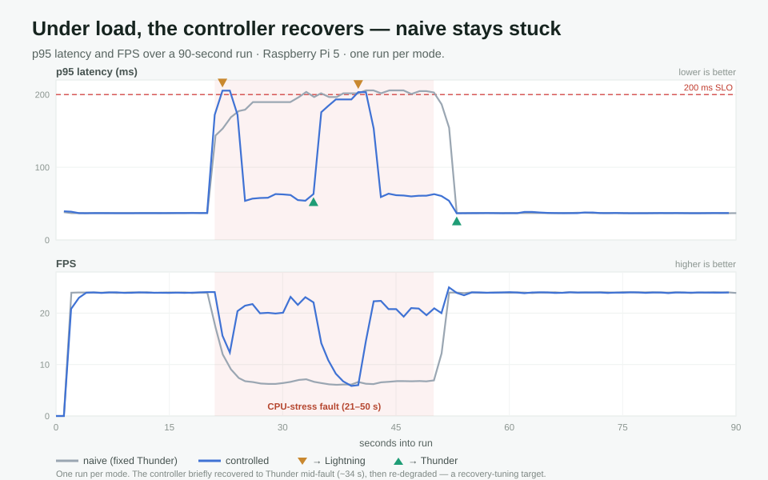

# Pose Guardian

Pose Guardian runs MoveNet pose estimation on a Raspberry Pi 5 and switches
between Thunder and Lightning when latency, temperature, or memory use gets too
high. The aim is to keep camera inference responsive under load, then return to
Thunder when conditions recover.

The project includes a controller, resource logging, and fault-injection scripts
for comparing automatic switching with a fixed model.

## Results

In four paired CPU-stress runs on one Pi 5, automatic switching reduced the total
number of logged latency violations from **35 to 14**. Average latency was lower
and FPS was higher in all four pairs. One pair had more violation rows with the
controller, so the reduction did not hold for every run.

| Across four paired runs | Fixed Thunder | Controller |
| --- | ---: | ---: |
| Total rows above the 200 ms latency target | 35 | 14 |
| Mean of each run's average rolling p95 latency | 93.2 ms | 64.9 ms |
| Mean inference time | 77.3 ms | 49.6 ms |
| Mean FPS | 13.4 | 15.4 |

Each run lasted 90 seconds, with eight CPU-stress workers active from 20–50
seconds. A violation is a roughly one-second log row whose rolling p95 latency
exceeds 200 ms; it is not a count of individual slow frames. The Pi used active
cooling and a live USB camera. None of these runs thermally throttled.

The plot below shows the first pair, rather than the four-run average:



The controller switched four times in that pair: it returned to Thunder while
the fault was still active, then switched back to Lightning. Recovery timing
still needs tuning. See the [individual run](docs/controlled_vs_naive.md) and
[four-run comparison](docs/repeated_cpu_stress.md) for the conditions and numbers.

## Run on a Raspberry Pi

Use Python 3.10 or 3.11 and a USB webcam. The recorded runs used Raspberry Pi OS
Bookworm, Python 3.11, an active cooler, and a 5 V / 5 A supply.

```bash
git clone https://github.com/ryokotaka/pose-guardian.git
cd pose-guardian
python3.11 -m venv .venv
source .venv/bin/activate
python -m pip install -e ".[dev]"
./models/download_models.sh
```

Start a 60-second camera run with automatic model switching:

```bash
python examples/run_controlled.py \
  --device 0 --model thunder --duration 60 --no-plot \
  --csv-output metrics/controlled_run.csv
```

Press `q` in the preview window to stop early. Add `--no-display` when running
over SSH. The CSV records model choice, controller actions, latency, FPS, and
resource measurements. Model files and generated logs are ignored by Git.

### Repeat the CPU-stress comparison

Run both modes with the same fault settings:

```bash
for mode in naive controlled; do
  python examples/run_controlled.py \
    --device 0 --model thunder --controller-mode "$mode" \
    --no-display --duration 90 --no-plot \
    --csv-output "metrics/${mode}_cpu_stress.csv" \
    --fault-scenario cpu_stress --fault-start-after 20 \
    --fault-duration 30 --fault-cpu-workers 8
done

python examples/compare_control_runs.py \
  --naive-csv metrics/naive_cpu_stress.csv \
  --controlled-csv metrics/controlled_cpu_stress.csv \
  --markdown-output metrics/comparison.md \
  --plot-output metrics/comparison.png
```

This runs each condition once. The table above summarizes four pairs. Live
camera input and device temperature can vary between runs; record those
conditions when comparing results.

## How switching works

Both models are loaded at startup. The controller selects which one handles the
next frame, using the latest resource snapshot and recent inference latency.

| State | Default trigger | Behavior |
| --- | --- | --- |
| Normal | Recovery conditions held for 10 seconds | Use Thunder |
| Degraded | Temperature ≥70 °C, memory ≥80%, or rolling p95 >200 ms | Use Lightning |
| Critical | Temperature ≥80 °C, memory ≥90%, or throttle flag | Skip about half the frames; also collect garbage when entering due to memory pressure |

Recovery uses lower thresholds and a hold timer. Returning from degraded to
normal requires temperature below 60 °C, memory below 70%, and p95 below 140 ms
once enough latency samples are available. Critical recovers through degraded
after 15 seconds below its recovery thresholds. CPU usage is logged but does not
directly trigger this policy. See [architecture](docs/architecture.md) and
[`src/resource_controller.py`](src/resource_controller.py).

## Model agreement and limits

On three recorded clips (540 evaluated frames), Lightning placed **97.4%** of
eligible keypoints within the configured distance of Thunder's predictions
(`PCK@0.05`). Thunder is the reference here, not human-labelled ground truth;
this measures agreement between models, not pose accuracy. Details are in the
[PCK evaluation](docs/pck_pseudo_gt.md).

The CPU-stress comparison does not include a fixed-Lightning baseline, so it
does not establish that switching is better than using Lightning throughout.
Memory pressure has a [smoke test](docs/memory_pressure_smoke.md), and camera
disconnect injection is not connected to the camera loop yet. Raw camera clips
and run CSVs are not included in the repository.

## Development

```bash
python -m pytest
```

Model inference tests skip when the MoveNet files or a compatible runtime are
missing. The remaining tests cover the controller, camera handling, telemetry,
fault injection, and reporting helpers.

The main entry point is [`examples/run_controlled.py`](examples/run_controlled.py).
[`src/pose_estimator.py`](src/pose_estimator.py) wraps the two models, and
[`src/resource_monitor.py`](src/resource_monitor.py) collects device telemetry.

[Thermal Guardian](https://github.com/ryokotaka/thermal-guardian) explores the
same switching approach for Q8/Q4 language-model inference on the Pi.

## License

[MIT](LICENSE). MoveNet weights are downloaded separately and have their own
licence terms.
